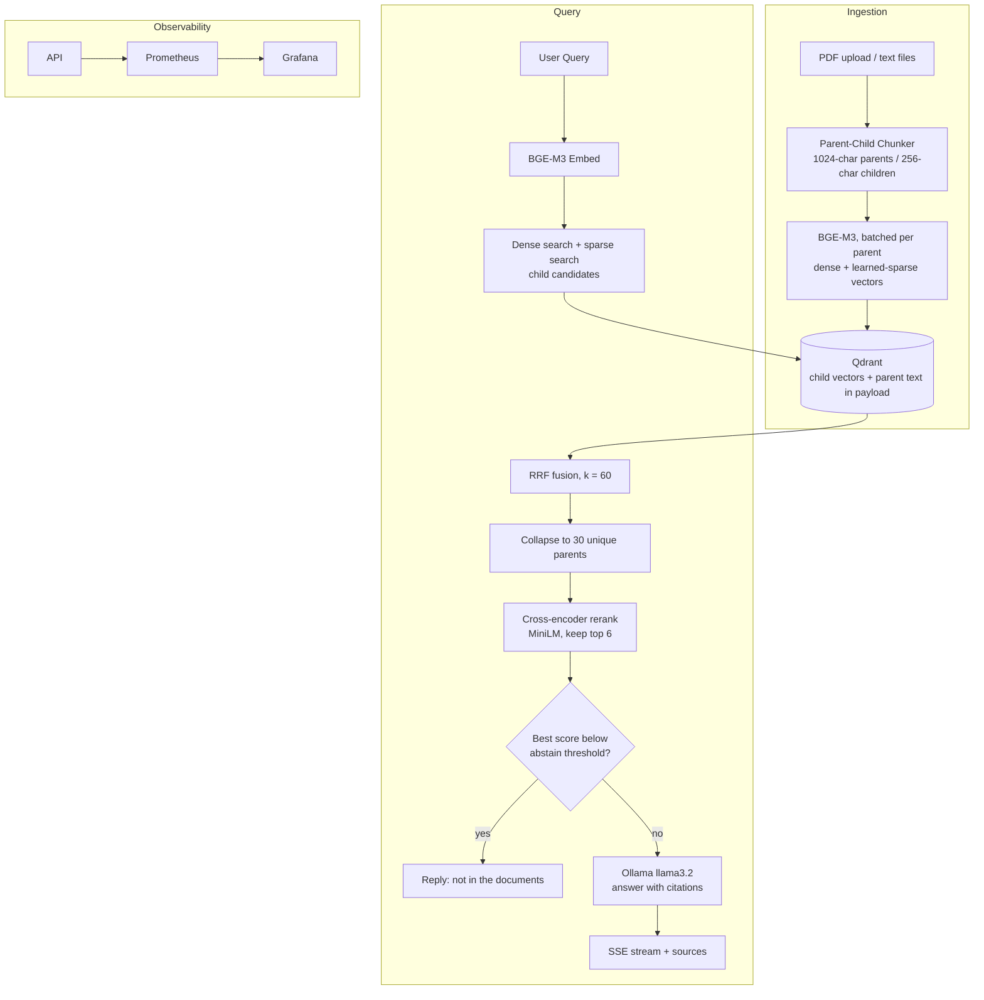

# Enterprise RAG

> Self-hosted hybrid-search RAG — BGE-M3 dense + learned-sparse vectors · hand-written RRF fusion · parent-child retrieval · cross-encoder reranking · abstention when retrieval is weak · cited, streaming answers · Prometheus observability · end-to-end evaluation

[](https://github.com/aarushi28902/enterprise-rag/actions/workflows/ci.yml)
[]()

## Architecture



## Key Design Decisions

| Decision | Alternative | Why |
|---|---|---|
| BGE-M3 dense + learned-sparse | Dense only, or BM25 | Exact terms and meaning from one model in one pass, free and local |
| Parent-child chunking | Fixed-size chunks | Search small children for precise matches; give the LLM the larger parent for context |
| Parent text in child payloads | Separate parent store | No second lookup at query time; each parent is copied into its ~5 children, fine at this scale |
| Hand-written RRF | Qdrant server-side fusion | Full control over k, per-retriever weighting and debugging; a few lines, unit-tested |
| Cross-encoder rerank (ms-marco-MiniLM-L-6) | Larger BGE reranker | 22M parameters, fast on CPU; reads query and passage together, so it judges relevance better than comparing vectors |
| Abstain on the reranker score | Abstain on RRF score, or let the LLM decide | RRF scores depend only on rank, so the top result always scores the same; the cross-encoder score reflects actual relevance. Refusing before generation saves an LLM call and can't be talked out of it |
| Ollama local LLM | Hosted API | Zero cost, no data leaves the machine; slower and weaker than a frontier model |
| End-to-end eval, fact-level answer key | One hand-picked gold passage per question | Measures what the pipeline actually retrieves; credits any passage that states the answer |

## Evaluation

`eval/run_pipeline_eval.py` runs 50 questions about the corpus through the real pipeline in five configurations and checks the top 6 passages against an answer key. A further 10 questions the corpus can't answer test abstention.

**The answer key** (`eval/datasets/taylor_swift_qa.jsonl`) lists, for each question, the facts its answer needs (56 facts) and every corpus sentence that states each fact (96 sentences, copied verbatim and checked by a unit test). A question counts as **answered** only when every one of its facts appears in a retrieved passage; a passage contains a sentence when it holds at least 90% of the sentence's words.

### Reranking ablation

RESULTS_PENDING

**Candidate recall** is the share of questions answered somewhere in the 30 candidates the reranker chooses from. It is the ceiling: a reranker only reorders, so it can't fix a question whose answer was never retrieved.

### Abstention

ABSTENTION_PENDING

### How this evaluation evolved

The first version matched one hand-picked passage per question and scored hybrid at 50%, dense at 60%. Reviewing every miss showed the key was wrong, not retrieval: the Wikipedia pages repeat facts across passages, and two gold passages didn't contain their answer. Rebuilding the key at fact level changed the conclusion (20 questions: hybrid 85%, dense 80%, sparse 80%), and the set was then grown to 50 questions so that differences between configurations are larger than one question.

Per-question results (retrieved passages, scores, latency) and a dated summary are in `eval/results/`. After changing only the answer key, `python -m eval.rescore` rescores the saved passages without Qdrant or the models. With `--ragas`, `run_pipeline_eval` also generates answers and scores RAGAS context precision and recall; `--full` adds faithfulness and answer relevancy, which are slow on CPU.

## Quick Start

```bash
# start Qdrant
./qdrant &

# start API
uvicorn src.rag.api.main:app --host 0.0.0.0 --port 8000 --reload

# ingest a document
curl -X POST http://localhost:8000/api/v1/ingest/pdf \
  -F "file=@your_document.pdf"

# query with streaming
curl -X POST http://localhost:8000/api/v1/query/stream \
  -H "Content-Type: application/json" \
  -d '{"query": "your question here"}' \
  --no-buffer
```

### Reproduce the evaluation

```bash
python -m scripts.ingest_taylor_swift      # recreates the collection from data/
python -m eval.run_pipeline_eval           # 5 configurations + abstention study
python -m eval.run_pipeline_eval --configs hybrid_rerank --ragas   # + RAGAS context metrics
python -m eval.rescore                     # rescore saved results after editing the answer key
pytest tests/                              # unit + API tests, no services needed
```

### Configuration

Settings come from environment variables or `.env` (see `src/rag/config.py`): `RERANK_ENABLED`, `RERANK_CANDIDATES` (default 30), `ABSTAIN_THRESHOLD` (set from the evaluation), `OLLAMA_URL`, `QDRANT_URL`.

## API Endpoints

| Method | Endpoint | Description |
|---|---|---|
| GET | `/health` | Health check |
| POST | `/api/v1/ingest/pdf` | Ingest PDF document |
| POST | `/api/v1/query/stream` | Stream an answer as server-sent events: answer tokens, then `[SOURCES]` (JSON list of the cited passages with source and score), then `[DONE]`. Low-confidence questions get "I couldn't find this in the documents." and an empty source list |
| GET | `/metrics` | Prometheus metrics |

## Metrics

- `rag_request_duration_seconds` — end-to-end latency histogram
- `rag_retrieval_duration_seconds` — Qdrant search latency
- `rag_rerank_duration_seconds` — cross-encoder reranking latency
- `rag_abstentions_total` — questions refused for low retrieval confidence
- `rag_generation_duration_seconds` — LLM generation latency
- `rag_docs_ingested_total` — total documents ingested
- `rag_active_requests` — currently active requests

## What I'd Do With More Time

- Replace CPU-based BGE-M3 with GPU inference for <100ms embedding latency
- Grow the unanswerable set beyond 10 questions so the abstention threshold rests on more evidence
- Check citations: verify each [n] in the answer points to a passage that supports the sentence
- Split on sentence boundaries and measure chunks in tokens rather than characters
- Move parent text to a separate store if the corpus grows large
- Add multi-tenancy with collection-per-tenant isolation
- Run the end-to-end eval in CI against a seeded Qdrant, with a GPU runner for faithfulness

## Stack

Python 3.11 · FastAPI · Qdrant · BGE-M3 · cross-encoder reranking · Ollama · Prometheus · RAGAS · pytest
