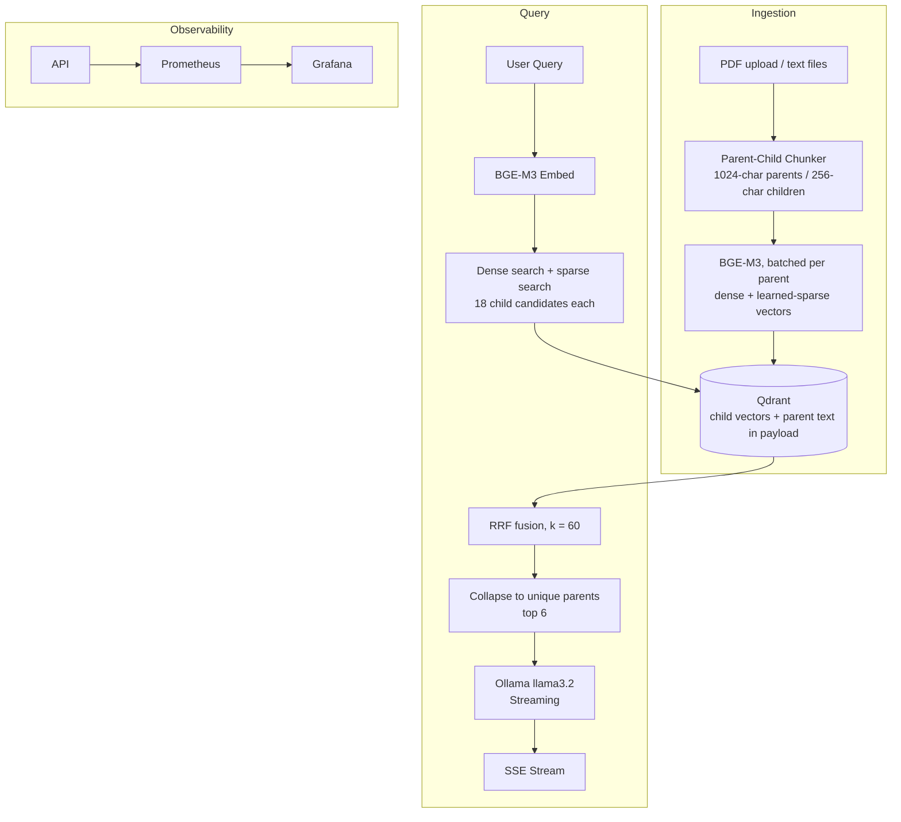

# Enterprise RAG

> Self-hosted hybrid-search RAG — BGE-M3 dense + learned-sparse vectors · hand-written RRF fusion · parent-child retrieval · streaming FastAPI · Prometheus observability · end-to-end evaluation

[](https://github.com/aarushi28902/enterprise-rag/actions/workflows/ci.yml)
[]()

## Architecture



## Key Design Decisions

| Decision | Alternative | Why |
|---|---|---|
| BGE-M3 dense + learned-sparse | Dense only, or BM25 | Exact terms and meaning from one model in one pass, free and local |
| Parent-child chunking | Fixed-size chunks | Search small children for precise matches; give the LLM the larger parent for context |
| Parent text in child payloads | Separate parent store | No second lookup at query time; each parent is copied into its ~5 children, fine at this scale |
| Hand-written RRF | Qdrant server-side fusion | Full control over k, per-retriever weighting and debugging; a few lines, unit-tested |
| Ollama local LLM | Hosted API | Zero cost, no data leaves the machine; slower and weaker than a frontier model |
| End-to-end eval | Scoring hand-picked passages | Measures what the pipeline actually retrieves, per retrieval mode |

## Evaluation

`eval/run_pipeline_eval.py` sends each of the 20 questions in `eval/datasets/taylor_swift_qa.jsonl` through the real retriever, in hybrid, dense-only and sparse-only modes. Each question has a gold passage from the corpus; a retrieved passage counts as a hit when it contains at least 90% of the gold passage's words.

| Mode | Hit rate @6 | MRR |
|---|---|---|
| Hybrid (RRF) | pending | pending |
| Dense only | pending | pending |
| Sparse only | pending | pending |

Per-question results and a dated summary are in `eval/results/`. With `--ragas`, the script also generates answers with the real generator and scores RAGAS context precision and recall; `--full` adds faithfulness and answer relevancy, which need several LLM calls per question and are slow on CPU.

## Quick Start

```bash
# start Qdrant
./qdrant &

# start API
uvicorn src.rag.api.main:app --host 0.0.0.0 --port 8000 --reload

# ingest a document
curl -X POST http://localhost:8000/api/v1/ingest/pdf \
  -F "file=@your_document.pdf"

# query with streaming
curl -X POST http://localhost:8000/api/v1/query/stream \
  -H "Content-Type: application/json" \
  -d '{"query": "your question here"}' \
  --no-buffer
```

### Reproduce the evaluation

```bash
python -m scripts.ingest_taylor_swift      # recreates the collection from data/
python -m eval.run_pipeline_eval           # retrieval metrics, all three modes
python -m eval.run_pipeline_eval --modes hybrid --ragas   # + RAGAS context metrics
pytest tests/                              # unit + API tests, no services needed
```

## API Endpoints

| Method | Endpoint | Description |
|---|---|---|
| GET | `/health` | Health check |
| POST | `/api/v1/ingest/pdf` | Ingest PDF document |
| POST | `/api/v1/query/stream` | Stream RAG response |
| GET | `/metrics` | Prometheus metrics |

## Metrics

- `rag_request_duration_seconds` — end-to-end latency histogram
- `rag_retrieval_duration_seconds` — Qdrant search latency
- `rag_generation_duration_seconds` — LLM generation latency
- `rag_docs_ingested_total` — total documents ingested
- `rag_active_requests` — currently active requests

## What I'd Do With More Time

- Replace CPU-based BGE-M3 with GPU inference for <100ms embedding latency
- Add cross-encoder reranking (ms-marco-MiniLM) between retrieval and generation
- Add a relevance threshold so weak retrieval returns "I don't know" instead of guessing
- Split on sentence boundaries and measure chunks in tokens rather than characters
- Move parent text to a separate store if the corpus grows large
- Add multi-tenancy with collection-per-tenant isolation
- Run the end-to-end eval in CI against a seeded Qdrant, with a GPU runner for faithfulness

## Stack

Python 3.11 · FastAPI · Qdrant · BGE-M3 · Ollama · Prometheus · RAGAS · pytest
